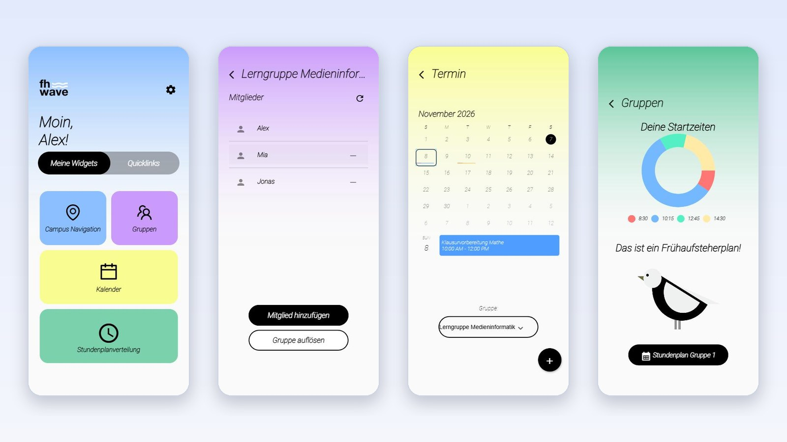

# FH-Wave – Studierenden-App der FH Kiel

**Live-Demo im Browser:** [l4223.github.io/FH-Wave-Demo](https://l4223.github.io/FH-Wave-Demo/) – startet direkt mit Beispieldaten, keine Anmeldung nötig.

FH-Wave bündelt den Studienalltag an der Fachhochschule Kiel in einer App: Lerngruppen mit gemeinsamem Kalender, Stundenplan-Auswertung, Campus-Navigation und Quicklinks, als frei anordnenbare Widgets auf dem Startbildschirm.



> **Teamprojekt.** FH-Wave ist im Sommersemester 2023 an der FH Kiel in einem Scrum-Team aus zehn Studierenden entstanden ([Original-Repository](https://github.com/L4223/FH-Wave)). Dieses Repository ist meine Fortführung: Es enthält die komplette Team-Historie und darauf aufbauend meine eigenen Erweiterungen (siehe unten).

## Funktionen

- **Widgets:** Startbildschirm mit Kacheln, die sich anordnen, entfernen und wieder hinzufügen lassen
- **Gruppen:** Lerngruppen anlegen, Mitglieder einladen, Einladungen annehmen oder ablehnen, Mitglieder entfernen, Gruppe auflösen
- **Gruppenkalender:** gemeinsame Termine pro Gruppe, mit Farbe und Uhrzeit
- **Stundenplanverteilung:** Auswertung der Startzeiten im Stundenplan („Frühaufsteherplan“)
- **Campus-Navigation** mit Lageplan, **Quicklinks** zu studienrelevanten Seiten
- **Einstellungen:** Dark Mode, Profil, Passwort zurücksetzen

## Mein Anteil im Team (2023)

| Bereich | Umsetzung |
| --- | --- |
| Projekt-Setup | Anlegen des Flutter-Projekts (Plattformen, Abhängigkeiten, erster Home-Screen), auf dem das Team aufgebaut hat |
| Gruppensystem | Gruppen anlegen und auflösen, Einladungen versenden und verwalten, Mitglieder hinzufügen und entfernen – mit Prüfungen, dass nur existierende Nutzer:innen eingeladen werden und niemand doppelt in einer Gruppe landet (`group_controller.dart`, `views/group_screens/`, `widgets/group_widgets/`) |
| Gruppenkalender | Kalenderansicht pro Gruppe und Erstellen gemeinsamer Termine (`group_calendar_screen.dart`, `appointment_screen.dart`) |
| Kalender | Überarbeitung der persönlichen Kalenderansicht |
| Dokumentation | Projekt-README |

Weitere Teammitglieder verantworteten u. a. Login und Registrierung, Stundenplan-Auswertung, Campus-Navigation, Quicklinks, das Figma-Design und die Scrum-Dokumentation.

## Meine Weiterentwicklung (2026)

Die Original-App hing an einem Firebase-Projekt des Teams und war ohne Konto nicht ausprobierbar. Ich habe sie so erweitert, dass sie öffentlich im Browser läuft:

- **Demo-Modus mit austauschbarem Backend:** Alle Firebase-Zugriffe laufen jetzt über eine zentrale Klasse [`Backend`](lib/services/backend.dart). Im Demo-Modus ersetzen In-Memory-Implementierungen ([`fake_cloud_firestore`](https://pub.dev/packages/fake_cloud_firestore), [`firebase_auth_mocks`](https://pub.dev/packages/firebase_auth_mocks)) Firestore und Auth und werden mit fiktiven Beispieldaten befüllt. Der echte Firebase-Betrieb bleibt per Schalter erhalten.
- **Web-Plattform:** Flutter-Web-Build, veröffentlicht über GitHub Pages.
- **Reproduzierbarer Build:** Abhängigkeiten auf Flutter 3.10 abgestimmt (u. a. `flutter_native_splash`, `pointycastle`), sodass das Projekt wieder ohne Fehler baut.
- **UI-Fix:** Lange Gruppennamen werden in der Titelleiste gekürzt statt aus dem Bild zu laufen.
- **Aufgeräumt:** Ein im Klartext dokumentiertes Test-Login aus der Entwickler-Doku entfernt.

## Tech-Stack

| Bereich | Technologie |
| --- | --- |
| App | Flutter 3.10, Dart 3, Provider |
| Backend | Firebase Authentication, Cloud Firestore |
| UI | Syncfusion Calendar, table_calendar, pie_chart, flutter_svg |
| Karten | Google Maps, Geolocator |
| Prozess | Scrum mit vier Sprints, GitLab CI, Figma |

## Lokal starten

Voraussetzung: [Flutter 3.10.6](https://docs.flutter.dev/release/archive) (neuere Versionen benötigen Anpassungen an den Abhängigkeiten).

```bash
git clone https://github.com/L4223/FH-Wave-Demo.git
cd FH-Wave-Demo
flutter pub get

# Demo mit Beispieldaten im Browser
flutter run -d chrome

# Mit echtem Firebase-Projekt (eigene Konfiguration in lib/firebase_options.dart)
flutter run --dart-define=DEMO=false
```

Der Demo-Modus ist im Web standardmäßig aktiv, auf Android, iOS und Desktop der echte Firebase-Betrieb. Beides lässt sich mit `--dart-define=DEMO=true|false` umstellen.

Web-Build für GitHub Pages:

```bash
flutter build web --release --base-href /FH-Wave-Demo/
```

## Projektstruktur

```text
lib/
├── controllers/     Logik für Nutzer, Gruppen, Kalender und Termine
├── services/        Backend: Umschaltung echtes Firebase / Demo-Daten
├── views/           Screens (Home, Gruppen, Kalender, Campus, Profil, Login)
│   └── widgets/     Wiederverwendbare Bausteine, u. a. group_widgets/
├── models/          Datenmodelle
└── main.dart        Einstiegspunkt
Doc/                 Scrum-Dokumentation, Figma-Entwürfe, Code-Style-Guidelines
third_party/         Angepasstes plugin_platform_interface für den Demo-Build
```

## Dokumentation aus dem Teamprojekt

Im Ordner [`Doc/`](Doc/) liegen Produktvision, Konkurrenz- und Risikoanalyse, Sprint-Dokumentationen, User Stories und die Figma-Klickdummys aus dem Projekt.
